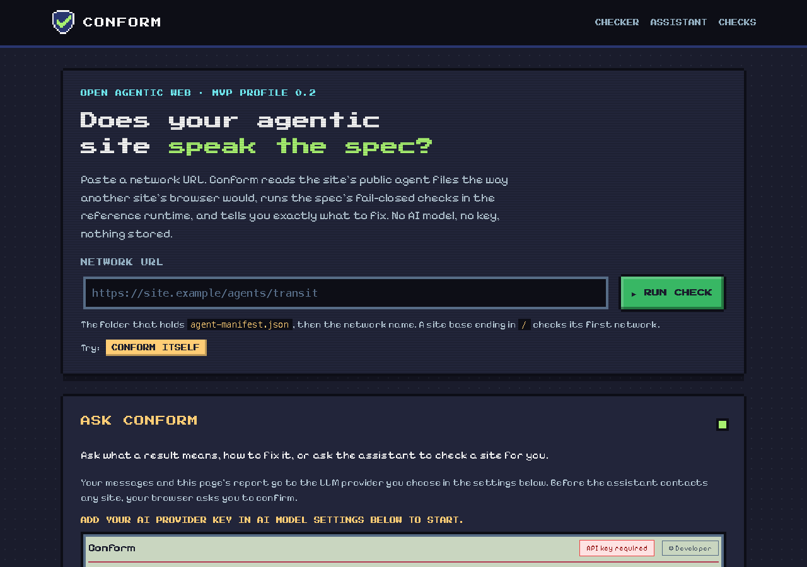
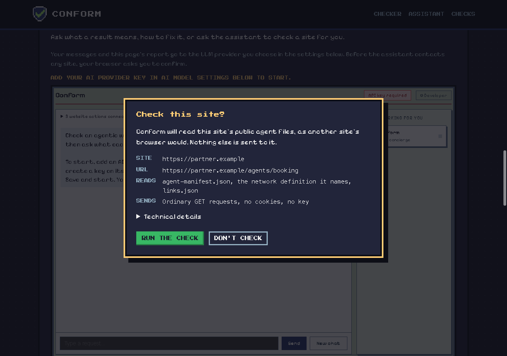
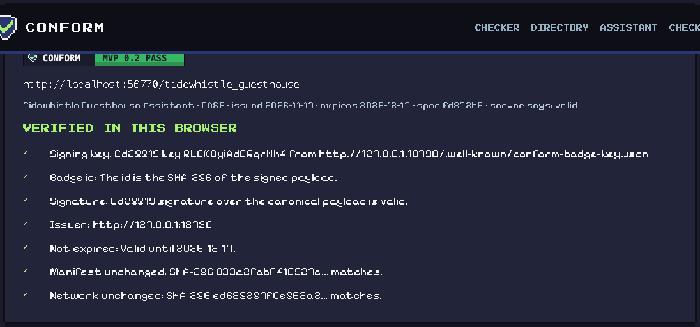

# Conform


**The conformance checker, badge and agent for the Open Agentic Web.**

Conform checks whether a published agentic website follows the
[Worldwide Agentic Web MVP specification](https://github.com/cognizant-ai-labs/agentic-web/blob/main/docs/worldwide_agentic_web_mvp_spec.md)
(Cognizant AI Lab, MVP Profile 0.2), produces a structured report with evidence for every MUST and MUST NOT it
can test, and will publish a signed badge, a directory of conforming sites, and an agent that other agentic
sites can call to ask "is this site conformant before I load it?".

Built for the [Open Agentic Web Challenge](https://cognizant-agenticweb.devpost.com/) (Cognizant, MIT NANDA,
Mozilla.ai, AWS). Open source, Apache-2.0.

## Background

The Open Agentic Web is a proposal for agents that live on ordinary websites: a site publishes a **data-only
agent network** (`agent-manifest.json` plus a Neuro SAN network definition in JSON), a **browser runtime**
runs that network in the visitor's own browser with the visitor's own LLM key, and one site's agents can load
and run another site's published agents after the visitor consents. No central registry, no agent server:
just HTTPS, CORS, JSON Schema and MCP.

That only works if independent sites really produce the same public artifacts and the same observable
behaviors. The specification lists the behaviors in §6 "MVP Interoperability Checks" and asks the community
for "conformance tests" in §7, and the reference repository's "Testing" section is still a TODO. Today a
site author has no way to know whether a caller on another origin can read their manifest, whether a wrong
network name fails closed, whether their peer references match their own peer policy, or whether a key or a
credential leaked into a public file.

Conform fills that gap:

- **A checker** (`packages/core`, TypeScript, no DOM, no LLM) that maps each requirement sentence of the spec
  to a concrete test and runs it against a live site. Static checks read the public artifacts the way a
  calling browser does. Harness checks load the site's real artifacts into the pinned reference runtime in
  Node (or in the browser) and prove the fail-closed behaviors: exact-name resolution, composition cycles,
  depth and budget limits, denied origins. Every result carries evidence and a suggestion, and the report
  is bound to the spec commit and runtime version it was checked against.
- **A site** (`apps/web`, pixel-art theme): paste a URL, run every check in the browser, read and share the
  report. The site is itself an agentic website: it publishes the `conform` network (its own assistant, with
  the visitor's key) and the `conform_check` network, which other agentic sites call to ask "is this site
  conformant?".
- **A service** (`apps/server`, one Node process with no dependencies outside this repository): Ed25519-signed
  badges bound to the SHA-256 of the manifest and network (they turn *stale* when the site changes), a public
  key for anyone to verify them, a searchable directory of badged sites, and an MCP endpoint
  (`check_site`, `badge_status`, `explain_check`) for other sites' runtimes. Guarded against SSRF.
- **Community tools**: the npm package `agentic-web-conformance` (`packages/cli`: a `conform check <url>` CLI and
  a JavaScript API, bundled with no dependencies, ready to publish) and a GitHub Action (`action/`) that checks a
  site on every push and writes the report to the job summary.
- **A demo caller** (`apps/demo-caller`, Waypoint Desk): a small agentic website that asks Conform before it
  calls a partner's agent, showing other sites calling Conform across origins.

## Screenshots







## Status

Application complete: checks C1–C9, CLI, site, assistant, badges, directory and MCP, all tested (84 tests).
Conform passes its own checks, also in Docker behind Caddy. Not yet hosted publicly.
[docs/PROGRESS.md](docs/PROGRESS.md), [docs/TEST-MATRIX.md](docs/TEST-MATRIX.md),
[docs/SPEC-NOTES.md](docs/SPEC-NOTES.md) and [docs/SAMPLE-REPORT.md](docs/SAMPLE-REPORT.md).

## Spec and runtime this version is bound to

| | |
| --- | --- |
| Specification | `docs/worldwide_agentic_web_mvp_spec.md`, "MVP Profile 0.2, 6 November 2026", commit `fd872b9221aeb8ff762b75a5badbf84b23c133cc` (2026-11-10) |
| Repository | [cognizant-ai-labs/agentic-web](https://github.com/cognizant-ai-labs/agentic-web) at `63a956cf4653f610b1c238c70946f4d7647d17a8` (2026-11-13) |
| Reference runtime | `skills/agentify-website/runtime/` = nsdeploy `53a787c` (2026-11-11) + the skill's edits, pinned in `packages/reference-runtime/` with SHA-256 hashes |
| Fixtures | the three agentified examples (pizza, guesthouse, harbor tours) and `serve_site.mjs`, pinned in `fixtures/upstream/` |

The spec changes often. `packages/core/src/spec.ts` holds these references and every report repeats them.

## Checks

| Check | What it proves | Spec | Mode |
| --- | --- | --- | --- |
| C1 Manifest | `agent-manifest.json` is reachable, JSON, readable cross-origin (CORS), has networks with `name`/`front_man`/`hocon`, router metadata and a peer policy; HTTPS; no cross-origin redirect | §3.2.1, §3.2.5, §3.3, §3.4, §5 | static |
| C2 Network entry | the requested name matches exactly; `hocon` resolves, fetches with CORS and parses; `links.json` is well formed; `front_man` is the agent the reference runtime would run | §3.2.5, §3.2.6, §3.3 | static |
| C3 Definition | Neuro SAN data model shape; references resolve; front agent; data-only (no `include`, `${...}`, local paths); explicit private-context allow rules; no credentials in public files | §2, §2.1, §2.2, §3.1, §5 | static |
| C4 Exact name | a wrong name fails closed in a caller's runtime; the right name instantiates without a model call | §3.2.5, §3.2, §5 | harness |
| C5 Limits | a composition cycle, the depth limit and the per-message budgets stop with visible errors before any contact | §3.1, §3.2.9, §5 | harness |
| C6 Origin policy | a denied origin is refused before any contact; the site's own peer references are allowed by its own policy | §2.1, §3.2.9, §3.3, §5 | harness |
| C7 Key never leaves | in a scripted conversation turn with a random canary key, only the caller's router receives the key; the site's manifest cannot switch the router; the key is in no prompt or trace | §3.2.2, §3.4, §4, §6 | harness |
| C8 Private context | private context (`sly_data`) never reaches the site's network by default; with an allow rule only the named field crosses | §2.1, §3.2.7, §5, §6 | harness |
| C9 Consent | consent is requested before the first request to the site, naming its origin and the request; a decline sends nothing; the site's page wires a consent card | §3.2.4, §5, §6 | harness |

Planned: C10 runtime fingerprint, C11 write confirmation, C12 coded-tool SRI, C13 links.json untouched, C14 BYOK panel.
The full requirement-to-check mapping is in [docs/TEST-MATRIX.md](docs/TEST-MATRIX.md).

Each finding has a status: `pass`, `fail`, `warn` (allowed but risky or a reference-implementation
extension), `info`, or `untestable` (with the reason). Checks never fail a site for omitting the reference
implementation's optional files (`agent-mcp.json`, `.well-known/nsdeploy*.json`, `actions.bridge`).

## Use

Requirements: Node.js 24 or newer, pnpm 11.

```shell
pnpm install
pnpm -r typecheck
pnpm -r test        # starts the fixture sites on free ports; nothing leaves the machine
```

### CLI

`packages/cli` is the `agentic-web-conformance` package with the `conform` command (npm publication is
planned; until then run it from this repository):

```shell
pnpm conform check https://site.example/agents/transit            # text report
pnpm conform check https://site.example/agents/transit --problems # only fail, warn, untestable
pnpm conform check https://site.example/agents/transit --json --out report.json
pnpm conform check https://site.example/ --static-only --fail-on warn
pnpm conform --help
```

Exit codes: `0` no failing finding, `1` a finding at or above `--fail-on` (default `fail`), `2` bad usage or a
crash. That makes it usable in CI as is; the GitHub Action will wrap it.

### Site and service

```shell
pnpm serve        # build the site and run everything on http://127.0.0.1:8787 (ephemeral dev key)
pnpm dev:server   # the service alone on :8787 (badges, directory, MCP)
pnpm dev:web      # the site with live reload on :5173, proxying the service
```

`apps/web/agent/` holds the sources of Conform's two networks and the manifest template. The build renders
them for `CONFORM_PUBLIC_ORIGIN`, runs the agentify-website skill's `build_network.mjs` (vendored, no Python)
on both, and copies the pinned runtime into `public/runtime/` after verifying its hashes.

Other agentic sites call Conform with the network URL `https://<conform origin>/conform_check` (list its
origin in their `allowed_peers`). Its agent uses Conform's MCP endpoint, so their visitors can ask whether a
site is conformant, or whether its badge is still valid, before calling it. Hosting on a VPS: [apps/web/deploy/README.md](apps/web/deploy/README.md).

### Library

```ts
import { checkNetwork } from "@conform/core";

const report = await checkNetwork("https://site.example/agents/transit");
console.log(report.summary.worst, report.checks.map((c) => `${c.id}:${c.status}`));
```

The input is a network URL (the folder that holds `agent-manifest.json`, then the network name), a site base
ending in `/`, or the manifest URL. Pass `{ staticOnly: true }` to skip the harness checks, or `{ fetch }` to
supply your own fetch (the tests use an in-memory site).

To check one of the committee's examples by hand:

```shell
node fixtures/upstream/serve_site.mjs fixtures/upstream/guesthouse_agentified --port 8090
pnpm conform check http://127.0.0.1:8090/tidewhistle_guesthouse   # in another shell
```

## Repository layout

```text
packages/core/              the checker: checks, report types, reference-runtime harness, tests
packages/reference-runtime/ pinned copy of the skill's browser runtime + SHA-256 hashes
packages/cli/               the `conform` CLI (npm package agentic-web-conformance)
apps/web/                   the Conform site (Vite + TS, pixel theme), its two agent networks, deploy configs
apps/server/                badges (Ed25519), directory, MCP endpoint, static serving; Clean Architecture (see its README)
apps/demo-caller/           Waypoint Desk, a demo site that calls Conform before it calls a partner
action/                     GitHub Action (runs the bundled CLI in action/dist)
submission/                 video intro and closing (Remotion), stills, video script
fixtures/upstream/          pinned committee examples + serve_site.mjs, used by the tests
docs/                       progress, test matrix, spec notes, sample report
```

## Rules of the road

- Conform only checks sites that opt in: the committee's examples, our own site, or sites listed publicly
  for the challenge. It reads a handful of public files once per run and never retries in a loop.
- The checker is deterministic and calls no model. The planned explainer agent uses the visitor's own key
  (BYOK) or Otari credits, as the spec intends.
- Reports never contain credentials: secret-looking values are masked before they reach a finding.

## License

Apache-2.0. The pinned reference runtime and the fixtures are copies from
[cognizant-ai-labs/agentic-web](https://github.com/cognizant-ai-labs/agentic-web) (Apache-2.0); see
`packages/reference-runtime/UPSTREAM.md` and `fixtures/upstream/UPSTREAM.md`.
