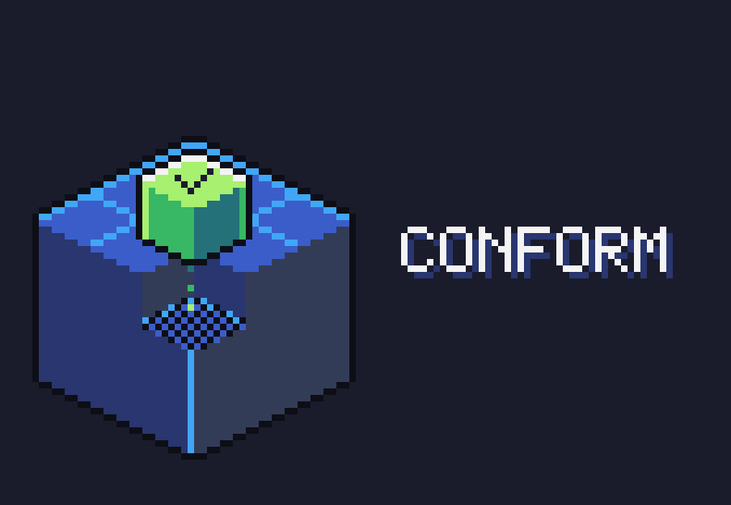

# The Conform mark: "The Keystone"

A 3×3×3 cube of identical voxels, drawn as true pixel art (isometric, 2:1 lines, Sweetie 16 palette), with
its front-top voxel lifted above its own slot. Generated by `apps/web/scripts/make-logo.mjs`; do not edit the
SVGs by hand.

## What it says

- **The cube is the shared specification.** Its three axes stand for the MVP profile's three tenets:
  a common multi-agent representation, browser execution, and pluggable inference. Every voxel is the
  same module, because a standard is what lets independent parts, built by people who never met, fit
  together.
- **The lifted voxel is a site being checked.** It has exactly the shape of its slot. That is
  conformance: not similarity, an exact fit (the spec's exact-name rule, its data-only network, its
  headers).
- **It hovers; it is not forced in.** A thin plumb line of light falls from it to the centre of the
  slot. Trust is earned by verification before contact, and anything that does not fit stays out: the
  spec's consent-before-contact and fail-closed rules.
- **The keystone carries a small check and the brightest color.** A conforming site does not just join
  the web; it is the piece that lets the rest hold, the way a keystone locks an arch.
- **The sides are a quiet monolith; only the front edge catches the light.** Rules should be calm and
  stable; the moment of verification is where the light is.

## Files

| File | Use |
| --- | --- |
| `conform-mark.svg` | The mark on a transparent background (also the site's favicon and header). |
| `conform-mark-dark.svg` | The mark on the site's ink background, with a margin. |
| `conform-lockup.svg` | Mark and pixel wordmark, for READMEs, slides and the video. |

Scale only by whole multiples and keep `image-rendering: pixelated` so the pixels stay square. Minimum
size: 26 px tall; below that, use the mark without the plumb line in mind (it becomes a lit cube).

## Palette (Sweetie 16)

| Role | Color |
| --- | --- |
| Top face / highlight | `#3b5dc9` / `#41a6f6` |
| Left face / right face | `#29366f` / `#333c57` |
| Keystone top / left / right | `#a7f070` / `#38b764` / `#257179` |
| Outline and check | `#0d0e16` / `#1a1c2c` |
